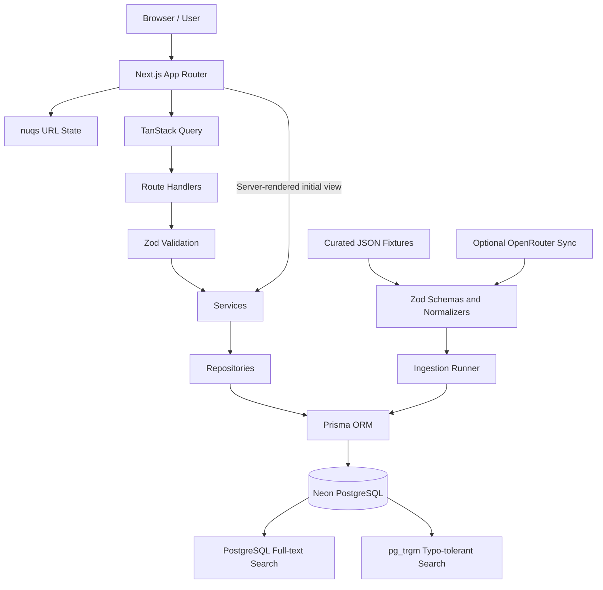

 <div align="center">

# OneAtlas

### Discover. Evaluate. Compare.

**A unified AI model discovery and intelligence workspace for developers, AI engineers, and researchers.**

Explore model capabilities, inspect provider offerings, compare models side by side, and navigate benchmark categories from one searchable catalogue.

<br />

[](https://oneatlas-glty.onrender.com)
[](https://github.com/aayushtiwari307/oneatlas/actions)
[](https://nextjs.org/)
[](https://www.typescriptlang.org/)
[](https://neon.tech/)

<br />

**[Try the live application](https://oneatlas-glty.onrender.com) · [Explore the source code](https://github.com/aayushtiwari307/oneatlas) · [Technical decisions](docs/DECISIONS.md)**

</div>

---

## The idea

Choosing an AI model is rarely just a matter of picking the newest or most popular name. Developers often need to weigh capability, context size, provider availability, cost, and benchmark results—and that information is spread across model catalogs, provider pages, and leaderboards.

**OneAtlas brings those discovery and evaluation tasks into one place.**

It provides a searchable model catalogue, detailed model profiles, side-by-side comparisons, rankings, AI lab and provider directories, and price-oriented insights.

> **Data transparency:** OneAtlas currently ships with a curated demo dataset. Some model specifications, provider associations, prices, and benchmark scores are illustrative rather than vendor-verified or live quotes. See [Data provenance and limitations](#data-provenance--limitations).

## Product features

| Feature | Description |
|---|---|
| **Model Explorer** | Search, filter, sort, and paginate through AI models. Switch between grid and table views. |
| **Model Details** | Inspect model specifications, modalities, capabilities, provider offerings, and benchmark information. |
| **Model Comparison** | Add models to a comparison tray and compare 2–4 models side by side. Share comparisons through URLs. |
| **Rankings & Benchmarks** | Explore benchmark leaderboards by category with direction-aware ordering and competition ranks. |
| **AI Labs Directory** | Discover organizations behind the models and explore their model catalogues. |
| **Inference Providers** | Browse inference providers and inspect their associated model offerings and prices. |
| **Global Search** | Use the Cmd/Ctrl + K command palette to search models, labs, and providers. |
| **Price & Usage Insights** | Explore price/performance data, estimate monthly token costs, and identify lower-priced provider offerings. |

### A typical user journey

1. Search for a model or narrow the catalogue using lab, provider, type, context, or price filters.
2. Open a model detail page to understand its specifications and listed offerings.
3. Add alternatives to the comparison tray and inspect them side by side.
4. Use rankings and price-oriented insights as additional evaluation signals.

---

## Architecture

OneAtlas separates the user interface, request validation, business logic, data access, and DTO mapping into distinct layers.



### Backend request lifecycle

Database-backed API requests follow a consistent flow:

1. **Route handler:** Receives the request and delegates through the shared route wrapper.
2. **Validation:** Zod parses query parameters and rejects invalid inputs.
3. **Service layer:** Applies business rules such as sorting, comparison alignment, and ranking behavior.
4. **Repository layer:** Performs Prisma/PostgreSQL reads and writes.
5. **Mapper layer:** Converts database records into stable DTOs, including Decimal-to-number conversion and date serialization.
6. **Client interface:** Consumes API data with TanStack Query, while nuqs keeps relevant search and filter state in the URL.

### Engineering highlights

- PostgreSQL full-text search uses a trigger-maintained `tsvector` search column.
- The `pg_trgm` extension supports typo-tolerant model-name matching.
- Provider prices are stored using PostgreSQL `Decimal` values per one million tokens.
- Lowest active provider prices are recomputed for efficient catalogue sorting and filtering.
- Model comparison preserves the order requested by the user.
- Rankings account for whether a benchmark is higher-is-better or lower-is-better and use competition ranking for ties.
- Database access is separated from API validation and business logic.

---

## Technology stack

| Layer | Technology |
|---|---|
| Application | Next.js 16 App Router, React 19, TypeScript (strict) |
| Styling | Tailwind CSS 4 |
| Backend | Node.js, Next.js Route Handlers, Zod 4 |
| Database | PostgreSQL on Neon |
| ORM | Prisma 6 |
| Client data management | TanStack Query 5 |
| URL state | nuqs |
| Unit testing | Vitest |
| Browser testing | Playwright with Chromium |
| Continuous integration | GitHub Actions |
| Hosting | Render Node.js Web Service |

---

## Repository structure

```text
oneatlas/
├── .github/
│   └── workflows/            # GitHub Actions CI
├── data/
│   └── curated/              # Offline demo fixtures and provenance notes
├── docs/                     # Technical decisions and project documentation
├── prisma/
│   ├── migrations/           # Committed database migrations
│   ├── sql/                  # Search extension and trigger SQL
│   ├── schema.prisma         # Database schema
│   ├── seed.ts               # Curated seed entry point
│   └── sync-openrouter.ts    # Optional external catalogue enrichment
├── public/                   # Static assets
├── src/
│   ├── app/                  # Pages, layouts, and API handlers
│   ├── components/           # Shared UI components
│   ├── features/             # Feature-specific UI and pure logic
│   ├── lib/                  # Helpers, query utilities, validators
│   ├── server/
│   │   ├── ingestion/        # Source schemas, normalizers, ingestion
│   │   ├── mappers/          # Database-to-DTO mapping
│   │   ├── repositories/     # Prisma data access
│   │   └── services/         # Application business logic
│   └── types/                # Shared DTO contracts
├── tests/
│   └── e2e/                  # Playwright smoke tests
├── .env.example              # Environment variable template
├── MILESTONES.md             # Project milestone tracker
└── README.md
```

---

## Getting started

### Prerequisites

- Node.js 22 or later
- npm
- PostgreSQL database
- Git

The deployed application uses [Neon](https://neon.tech/) for hosted PostgreSQL.

### 1. Clone the repository

```bash
git clone https://github.com/aayushtiwari307/oneatlas.git

cd oneatlas
```

### 2. Install dependencies

```bash
npm ci
```

The project's post-install script generates the Prisma Client.

### 3. Configure environment variables

Create your local `.env` file:

**Windows PowerShell**

```powershell
Copy-Item .env.example .env
```

Configure the database connection strings:

```dotenv
DATABASE_URL="YOUR_NEON_POOLED_CONNECTION_STRING"

DIRECT_URL="YOUR_NEON_DIRECT_CONNECTION_STRING"
```

Use the pooled Neon connection string for `DATABASE_URL` and the direct connection string for `DIRECT_URL`.

Keep `.env` private. Database credentials must never be committed to GitHub or included in screenshots and recordings.

### 4. Apply database migrations

For a fresh development database:

```bash
npx prisma migrate dev
```

For an existing production database:

```bash
npx prisma migrate deploy
```

Do not use `migrate dev` against production.

### 5. Seed the catalogue

```bash
npm run seed
```

The curated seed reads local JSON fixtures and upserts the catalogue into PostgreSQL. It requires a reachable database.

Optional OpenRouter enrichment can be run separately:

```bash
npm run sync:openrouter
```

This optional integration is not required to bootstrap the application.

### 6. Start the development server

```bash
npm run dev
```

Open:

**http://localhost:3000**

---

## API overview

OneAtlas exposes the following read endpoints:

| Endpoint | Purpose |
|---|---|
| `GET /api/health` | Database connectivity check. |
| `GET /api/models` | Model search, filtering, sorting, and pagination. |
| `GET /api/models/[slug]` | Individual model details. |
| `GET /api/models/compare?slugs=a,b` | Compare two to four models. |
| `GET /api/search?q=...` | Grouped model, lab, and provider search. |
| `GET /api/rankings` | Benchmark leaderboard. |
| `GET /api/benchmarks` | Benchmark catalogue and model counts. |
| `GET /api/labs` | AI lab directory. |
| `GET /api/labs/[slug]` | Individual lab details. |
| `GET /api/providers` | Inference provider directory. |
| `GET /api/providers/[slug]` | Individual provider details. |
| `GET /api/filters` | Global filter options, counts, and ranges. |
| `GET /api/insights/price-performance` | Benchmark scores and blended-price insights. |

### Response conventions

Successful responses use:

```json
{
  "data": [],
  "meta": {}
}
```

Error responses use:

```json
{
  "error": {
    "code": "ERROR_CODE",
    "message": "Description of the error"
  }
}
```

Query parameters are validated using Zod schemas.

### Quick API checks

With the local application running:

```powershell
Invoke-RestMethod "http://localhost:3000/api/health" |
  ConvertTo-Json -Depth 5

Invoke-RestMethod "http://localhost:3000/api/models?limit=5" |
  ConvertTo-Json -Depth 5

Invoke-RestMethod "http://localhost:3000/api/filters" |
  ConvertTo-Json -Depth 5
```

A healthy database-backed health response returns `data.status` as `ok` and `data.db` as `true`.

---

## Testing and quality

OneAtlas includes unit tests, browser-based end-to-end tests, static analysis, and production-build verification.

### Run the verification suite

```bash
npm run typecheck
npm run lint
npm test
npm run build
```

### End-to-end tests

The Playwright smoke suite requires a migrated and seeded database and Chromium:

```bash
npx playwright install chromium

npm run test:e2e
```

The browser tests cover:

1. Model search, filtering, opening a model detail page, and adding the model to comparison.
2. Adding two models and rendering the shareable comparison page.

To run the browser tests against the hosted application:

```powershell
$env:PLAYWRIGHT_BASE_URL = "https://oneatlas-glty.onrender.com"

npm run test:e2e
```

### Latest verified results

<details>
<summary><strong>Verification results — 21 November 2026</strong></summary>

| Check | Result |
|---|---|
| TypeScript typecheck | Passed |
| ESLint | Passed |
| Vitest | 146 tests passed across 27 files |
| Next.js production build | Passed |
| Playwright / Chromium | 2 end-to-end tests passed |
| GitHub Actions CI | Passed |

</details>

The GitHub Actions workflow runs dependency installation, Prisma Client generation, linting, TypeScript checks, unit tests, and the production build. Playwright is maintained as a separate seeded-database smoke suite.

---

## Deployment

OneAtlas is deployed as a **Node.js Web Service on Render**, with Neon PostgreSQL providing persistent database storage.

<div align="center">

### Live application

[](https://oneatlas-glty.onrender.com)

**https://oneatlas-glty.onrender.com**

</div>

### Render configuration

| Setting | Value |
|---|---|
| Runtime | Node |
| Branch | `master` |
| Region | Singapore |
| Root directory | Repository root |
| Build command | `npm ci && npm run build` |
| Start command | `npx prisma migrate deploy && npm run start` |
| Node version | `22.18.0` |
| Health check path | `/api/health` |

### Required environment variables

| Variable | Purpose |
|---|---|
| `DATABASE_URL` | Neon pooled connection for runtime database queries. |
| `DIRECT_URL` | Neon direct connection for Prisma migrations. |
| `NODE_VERSION` | Node.js version `22.18.0`. |

Render provides the application port through the `PORT` environment variable.

The configured start command applies pending committed migrations before starting the Next.js application.

Never add database credentials to the source repository.

---

## Data provenance and limitations

The current curated demo dataset contains:

| Record type | Count |
|---|---:|
| AI labs / model organizations | 15 |
| Inference providers | 10 |
| Benchmark definitions | 8 |
| Model catalogue entries | 62 |
| Provider-model associations | 75 |
| Benchmark score rows | 80 |

Benchmark scores cover 50 models.

**Important: This is a curated demonstration dataset, not a fully live, vendor-verified catalogue or pricing feed.**

In particular:

- Model release dates, context windows, output limits, modalities, capabilities, open-weight flags, and descriptions include illustrative fixture metadata.
- Provider-model associations do not prove that a provider currently serves a particular model.
- Provider prices, latency, throughput, and quantization values are illustrative and should not be treated as live quotes or service guarantees.
- Benchmark names and source links identify public benchmark projects or papers, but the numeric fixture scores are synthetic demo values.
- Curated benchmark score rows are marked with `source: "illustrative"`.
- Optional OpenRouter enrichment does not convert illustrative benchmark scores into verified results.

OneAtlas distinguishes three data categories:

- **Real:** Retrieved from a source integration, with source and retrieval context recorded where supported.
- **Curated:** Manually checked against cited public sources, with source URLs retained.
- **Illustrative:** Synthetic or otherwise unverified demonstration values.

The current `/api/filters` endpoint returns global counts and ranges rather than faceted counts. This is an intentional MVP behavior.

See [`data/curated/README.md`](data/curated/README.md) for the fixture-level provenance statement and [`docs/DECISIONS.md`](docs/DECISIONS.md) for implementation decisions.

---

## Project documentation

Additional project documentation:

| Document | Description |
|---|---|
| [`docs/DECISIONS.md`](docs/DECISIONS.md) | Technical and product decisions. |
| [`docs/FINAL_TEST_PLAN.md`](docs/FINAL_TEST_PLAN.md) | Manual acceptance and verification checklist. |
| [`docs/LOOM_SCRIPT.md`](docs/LOOM_SCRIPT.md) | Project walkthrough outline for the demo recording. |
| [`MILESTONES.md`](MILESTONES.md) | Project milestone tracker. |

---

<div align="center">

## OneAtlas

**Make AI model discovery and evaluation easier to navigate.**

Discover. Evaluate. Compare.

[Live Application](https://oneatlas-glty.onrender.com) · [GitHub Repository](https://github.com/aayushtiwari307/oneatlas)

</div>
