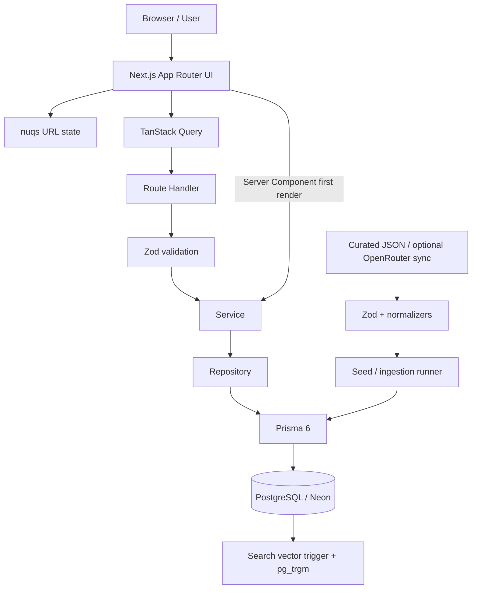

# OneAtlas

**OneAtlas** is an AI model discovery and intelligence platform for developers, AI engineers and researchers. It brings model discovery, provider pricing, model comparisons, benchmark rankings, AI lab/provider directories and price-oriented insights into one searchable catalogue.

> **Project status (21 November 2026):** the owner reports that local TypeScript, ESLint, Vitest and production-build checks pass. Neon migrations/seeding, database-backed HTTP checks, Playwright browser tests, Vercel deployment and the final visual/accessibility walkthrough are deliberately still pending. Do not treat this repository as production-deployed until those checks are completed.

## What the MVP includes

- **Model discovery:** searchable, filterable and sortable catalogue with pagination and grid/table layouts.
- **Model details:** specifications, modalities, capabilities, active provider offerings, benchmark scores and related models.
- **Model comparison:** shareable side-by-side comparisons for two to four models, with best-value highlighting.
- **Rankings:** category and benchmark leaderboards with direction-aware score ordering and competition ranks.
- **Labs and providers:** searchable directories, detail pages and provider-specific model pricing.
- **Global search:** Cmd/Ctrl+K search palette with grouped model, lab and provider results.
- **Insights:** price/performance scatter plot, monthly token-cost estimator and cheapest-input-provider indicators.

## Technology stack

| Area | Technology |
|---|---|
| Web application | Next.js 16 App Router, React 19, TypeScript (strict) |
| Styling | Tailwind CSS 4 |
| API | Next.js Route Handlers, Node.js, TypeScript, Zod 4 |
| Data access | PostgreSQL, Prisma ORM 6 |
| Client data fetching | TanStack Query 5 |
| URL state | nuqs |
| Unit tests | Vitest |
| Browser smoke tests | Playwright (Chromium) |
| Deployment target | Vercel + Neon PostgreSQL |

Versions are pinned or constrained in `package.json`. Prisma and `@prisma/client` intentionally remain on major version 6 to match the assignment's architecture and schema.

## Architecture

The application keeps transport, validation, business logic and persistence separate. Interactive browser features call the actual `/api` routes; server-rendered pages may call services directly for their first render. Prisma rows are mapped to API DTOs, and Decimal-to-number conversion happens at the mapper boundary.



### Request and data flow

1. **Route Handler:** reads request parameters and delegates through the shared `route(...)` wrapper.
2. **Validation:** Zod parses and rejects malformed or unknown user-controlled query inputs.
3. **Service:** applies product rules such as default sorting, comparison alignment and competition ranking.
4. **Repository:** performs Prisma/PostgreSQL queries; raw SQL uses tagged `$queryRaw` templates.
5. **Mapper:** returns stable DTOs, converts Prisma `Decimal` to numbers and serializes dates.
6. **UI:** server components render initial data; interactive search, filters, compare and the command palette use TanStack Query against the API. nuqs keeps shareable state in the URL.

### Database and search design

- `ModelProvider` stores provider-specific input/output prices as PostgreSQL `Decimal` values per one million tokens.
- `Model.minInputPrice` and `Model.minOutputPrice` are denormalized values derived from the same cheapest active offering so filtering and price sorting do not need to aggregate offerings for every catalogue query.
- PostgreSQL full-text search uses a trigger-maintained `tsvector`; `pg_trgm` supports typo-tolerant model-name matching.
- The search trigger and trigram extension are added to the generated migration using `prisma/sql/search_setup.sql` (instructions below).
- Read endpoints use the shared success/error envelope and cache headers defined by the API contract. Database-backed route segments remain dynamic; the Next.js `cacheComponents` option is disabled because it conflicts with the project's required `force-dynamic` route-segment configuration.

## Repository map

```text
prisma/
  schema.prisma
  sql/search_setup.sql
  seed.ts
  sync-openrouter.ts

data/curated/                 Offline curated fixture JSON + provenance note
docs/
  SPEC.md                     API/data/UI contracts
  DECISIONS.md                Technical decision log
  FINAL_TEST_PLAN.md          Owner-run acceptance checklist
  LOOM_SCRIPT.md              Suggested recording outline
src/
  app/api/                    Thin Route Handlers
  app/                        Pages and layouts
  components/                 UI and feature components
  features/                   Client-side state and pure UI logic
  lib/api/                    Shared API envelope and handler helpers
  lib/validators/             Zod request schemas
  server/repositories/        Prisma queries
  server/services/            Business logic
  server/mappers/             Database-to-DTO mapping
  server/ingestion/           Seed/OpenRouter ingestion and normalization
  types/                      Shared DTO contracts
tests/e2e/                    Playwright smoke tests
.github/workflows/ci.yml      Database-independent CI
```

## Local setup

### Requirements

- Node.js 22 or later.
- npm.
- A PostgreSQL database. Neon is the intended hosted option.
- Git.

### Install

```powershell
npm install
```

For a clean checkout after the lockfile has been committed, prefer `npm ci` to reproduce the locked dependency graph.

Copy `.env.example` to `.env` and set the two connection strings. Use the Neon **pooled** connection for application queries and the **direct** connection for Prisma migrations:

```dotenv
DATABASE_URL="YOUR_NEON_POOLED_CONNECTION_STRING"
DIRECT_URL="YOUR_NEON_DIRECT_CONNECTION_STRING"
```

Never commit `.env` or paste database credentials into issues, chat messages or Loom recordings.

### Create the database schema

The project uses Prisma 6 and PostgreSQL. The search extension and trigger SQL must be included in the initial migration:

```powershell
npx prisma migrate dev --name init --create-only
```

Open the generated `prisma/migrations/*_init/migration.sql` and:

1. Prepend **Part 1** from `prisma/sql/search_setup.sql` (the `pg_trgm` extension).
2. Append **Part 2** from `prisma/sql/search_setup.sql` (the model search-vector function and trigger).
3. Save the migration, then apply it:

```powershell
npx prisma migrate dev
npx prisma generate
```

For production, apply committed migrations with `npx prisma migrate deploy`; do not use `migrate dev` against production.

### Seed curated data

```powershell
npm run seed
```

The seed reads local JSON files and does not need the OpenRouter API. A reachable PostgreSQL database is still required because the command writes those records into the database. Seeding is designed to be idempotent.

Optional external enrichment:

```powershell
npm run sync:openrouter
```

This requires network access and is not required to bootstrap the app. It must not delete curated rows.

### Run the app

```powershell
npm run dev
```

Open `http://localhost:3000`.

## Quality checks

The owner reports these local checks passed on 21 November 2026 after applying the M8 root integration fix:

```powershell
npm run typecheck
npm run lint
npm test
npm run build
```

Reported results: TypeScript passed, ESLint passed, Vitest passed **146 tests across 27 files**, and the Next.js production build completed. These local checks do not prove that the PostgreSQL schema is migrated, that database-backed APIs return data, or that the browser workflows pass against a seeded catalogue.

Playwright tests require `@playwright/test`, a Chromium installation, and a migrated/seeded database (or a configured deployed target):

```powershell
npx playwright install chromium
npm run test:e2e
```

The E2E suite contains two smoke paths: model search/filter/detail/add-to-compare, and two-model comparison. It is intentionally separate from the database-independent unit suite.

## API overview

| Endpoint | Purpose |
|---|---|
| `GET /api/health` | Database connectivity probe (`SELECT 1`) |
| `GET /api/models` | Search, filters, sort and pagination |
| `GET /api/models/[slug]` | Model detail DTO |
| `GET /api/models/compare?slugs=a,b` | Compare two to four models |
| `GET /api/search?q=...` | Grouped model, lab and provider search |
| `GET /api/rankings` | Benchmark leaderboard |
| `GET /api/benchmarks` | Benchmark catalogue and model counts |
| `GET /api/labs`, `GET /api/labs/[slug]` | AI lab directory and detail |
| `GET /api/providers`, `GET /api/providers/[slug]` | Provider directory and provider-specific model prices |
| `GET /api/filters` | Global filter values and ranges |
| `GET /api/insights/price-performance` | Benchmark score and blended-price points |

Success responses use `{ data, meta? }`; failures use `{ error: { code, message, details? } }`. Query parameters are validated with Zod. Read endpoints use the configured shared cache policy.

## Data provenance and honesty

The current offline fixture catalogue contains:

- 15 lab records and 10 provider records;
- 8 benchmark definitions;
- 62 model entries;
- 80 benchmark-score rows covering 50 models.

**Do not treat the curated fixtures as vendor-verified catalogue data.** The model metadata (release dates, context sizes, modalities, capabilities, open-weight flags and descriptions), offering prices, model/provider associations, latency/throughput/quantization values and numeric benchmark scores are illustrative. All curated benchmark score rows use `source: "illustrative"`. Lab and provider names/websites are directory references; a listed association does not prove that a provider currently serves a model. See `data/curated/README.md` for the detailed provenance statement.

Use these labels consistently:

- **Real:** values fetched from a source integration such as a successfully executed OpenRouter sync. Record the source and retrieval context where the data model allows it.
- **Curated:** values manually verified against cited public sources. Keep source URLs in the relevant records/documentation.
- **Illustrative:** synthetic or otherwise unverified demo values. Never display them as published benchmark results or current provider quotes.

The OpenRouter sync has been implemented and its response shape was reviewed, but the owner has not yet run it against a migrated database. Therefore this README does **not** claim that the current local fixtures have been refreshed from OpenRouter.

The detailed product spec targets 60–80 models; the separate M2 milestone text says 100+. The present 62-model fixture follows the detailed spec range. This scope discrepancy remains open and should be resolved before describing the 100+ target as met.

## Known limitations and outstanding verification

1. **Database is not configured yet:** Neon project creation, migration application, seed execution and database SQL checks are deferred. Database-backed API behavior is not yet verified by curl.
2. **No deployed live URL:** Vercel project/environment configuration, production migrations, production seed and live-site checks remain outstanding.
3. **E2E not run:** Chromium download was interrupted previously. Re-run the documented install and Playwright smoke tests after the database is seeded.
4. **Manual UI checks remain:** visually verify 375px, 768px and 1440px; keyboard navigation, focus order, contrast, reduced motion, mobile behavior and Lighthouse scores.
5. **MVP filter counts are global, not faceted:** `/api/filters` reports global catalogue counts as documented in the spec.
6. **No authentication or admin ingestion console:** this is a public discovery MVP; curated data changes use the seed/sync scripts.
7. **Provider availability and price volatility:** fixture provider associations/prices are illustrative. Even source-backed pricing can change and should be refreshed before relying on it commercially.
8. **Benchmark coverage and comparability:** benchmark data may be missing for a model; score interpretation must respect benchmark units and `higherIsBetter`. Illustrative scores are not independent evaluations.
9. **Cost estimate scope:** calculator excludes cached-input discounts, taxes, provider minimum charges and other billing-specific adjustments.
10. **Security audit follow-up:** the owner's `npm audit` output reported four high-severity findings associated with transitive `deepmerge-ts` and `effect` dependencies pulled through Prisma tooling. `npm audit fix --force` proposed upgrading Prisma to major version 7, which conflicts with the required Prisma 6 stack. Do not apply that forced upgrade; review a compatible Prisma 6 patch/update path and rerun the audit before production deployment.
11. **Prisma config deprecation:** Prisma 6 emitted a warning that `package.json#prisma` seed configuration will be removed in Prisma 7. This is non-blocking for the pinned Prisma 6 stack, but should be migrated to `prisma.config.ts` as a separate, version-appropriate change before any Prisma major upgrade.

## Technical decision log

See [`docs/DECISIONS.md`](docs/DECISIONS.md) for the detailed decisions and trade-offs. The most important are the route → Zod → service → repository → mapper structure, Prisma Decimal conversion at the mapper boundary, PostgreSQL full-text/trigram search, URL-driven UI state, offline curated seeding, optional OpenRouter enrichment and explicit illustrative-data labelling.

## Final acceptance checklist

The authoritative, step-by-step checklist is [`docs/FINAL_TEST_PLAN.md`](docs/FINAL_TEST_PLAN.md). The project is not submission-ready until the database, HTTP/API, UI, Playwright, deployment, live-site, Loom and form-submission items are completed.
